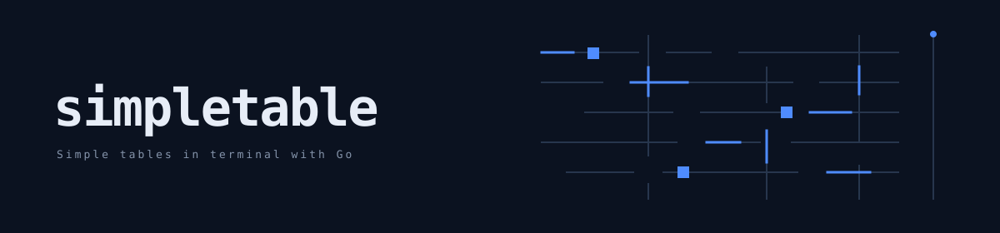

# Simple tables in terminal with Go



[](https://github.com/alexeyco/simpletable/actions/workflows/quality-gates.yml)&nbsp;[](https://coveralls.io/github/alexeyco/simpletable?branch=master)&nbsp;[](https://pkg.go.dev/github.com/alexeyco/simpletable)&nbsp;[](LICENSE)

Build readable terminal tables in Go with seven built-in styles, multiline cells, alignment, and column spanning.

## Comparison

✅ documented · ⚠️ partial · ❌ not found in sources checked. The last status means the sources checked did not document the feature; it does not establish that the library lacks it. Each symbol links to the public source checked for that comparison.

| Feature | [simpletable](https://github.com/alexeyco/simpletable) | [termtables](https://pkg.go.dev/github.com/apcera/termtables) | [uitable](https://github.com/gosuri/uitable) | [tablewriter](https://github.com/olekukonko/tablewriter) | [go-pretty](https://github.com/jedib0t/go-pretty) |
| --- | --- | --- | --- | --- | --- |
| Multiline cell content | [✅](https://github.com/alexeyco/simpletable/blob/master/_example/04-multiline/main.go) | [❌](https://pkg.go.dev/github.com/apcera/termtables) | [⚠️](https://github.com/gosuri/uitable#example-usage) | [⚠️](https://github.com/olekukonko/tablewriter#advanced-examples) | [❌](https://github.com/jedib0t/go-pretty/tree/main/table) |
| Explicit column spans | [✅](https://github.com/alexeyco/simpletable/blob/master/cell.go) | [✅](https://pkg.go.dev/github.com/apcera/termtables#CellStyle) | [❌](https://pkg.go.dev/github.com/gosuri/uitable) | [⚠️](https://github.com/olekukonko/tablewriter#examples) | [⚠️](https://github.com/jedib0t/go-pretty/tree/main/table) |
| Markdown output | [✅](https://github.com/alexeyco/simpletable/blob/master/style.go) | [✅](https://pkg.go.dev/github.com/apcera/termtables#Table.SetModeMarkdown) | [❌](https://github.com/gosuri/uitable) | [✅](https://github.com/olekukonko/tablewriter#key-features) | [✅](https://github.com/jedib0t/go-pretty) |
| Alignment controls | [✅](https://github.com/alexeyco/simpletable/blob/master/cell.go) | [✅](https://pkg.go.dev/github.com/apcera/termtables#Table.SetAlign) | [⚠️](https://pkg.go.dev/github.com/gosuri/uitable#Table.RightAlign) | [✅](https://github.com/olekukonko/tablewriter#examples) | [✅](https://github.com/jedib0t/go-pretty/tree/main/table) |
| Custom table styles | [✅](https://github.com/alexeyco/simpletable/blob/master/style.go) | [✅](https://pkg.go.dev/github.com/apcera/termtables#TableStyle) | [❌](https://pkg.go.dev/github.com/gosuri/uitable) | [✅](https://github.com/olekukonko/tablewriter#key-features) | [✅](https://github.com/jedib0t/go-pretty/tree/main/table) |

Sources checked on 2026-11-09. Add a library as a column or a feature as a row, and link each status to the public source checked.

## Quick start

```go
package main

import (
	"fmt"
	"strings"

	"github.com/alexeyco/simpletable"
)

func main() {
	table := simpletable.New()
	table.Header = &simpletable.Header{
		Cells: []*simpletable.Cell{
			{Align: simpletable.AlignCenter, Text: "#"},
			{Align: simpletable.AlignCenter, Text: "NAME"},
			{Align: simpletable.AlignCenter, Text: "TAX"},
		},
	}
	rows := []struct {
		name string
		tax  float64
	}{
		{"Newton G. Goetz", 532.70},
		{"Rebecca R. Edney", 1423.25},
		{"John R. Jackson", 7526.12},
		{"Ron J. Gomes", 123.84},
		{"Penny R. Lewis", 3221.11},
	}

	total := 0.0
	for i, row := range rows {
		table.Body.Cells = append(table.Body.Cells, []*simpletable.Cell{
			{Align: simpletable.AlignRight, Text: fmt.Sprintf("%d", i+1)},
			{Text: row.name},
			{Align: simpletable.AlignRight, Text: fmt.Sprintf("$ %.2f", row.tax)},
		})

		total += row.tax
	}
	table.Footer = &simpletable.Footer{
		Cells: []*simpletable.Cell{
			{Align: simpletable.AlignRight, Span: 2, Text: "Subtotal"},
			{Align: simpletable.AlignRight, Text: fmt.Sprintf("$ %.2f", total)},
		},
	}
	table.SetStyle(simpletable.StyleCompactLite)

	for _, line := range strings.Split(table.String(), "\n") {
		fmt.Println(strings.TrimPrefix(strings.TrimRight(line, " "), " "))
	}
}
```

```
#         NAME            TAX
--- ------------------ ------------
1   Newton G. Goetz      $ 532.70
2   Rebecca R. Edney    $ 1423.25
3   John R. Jackson     $ 7526.12
4   Ron J. Gomes         $ 123.84
5   Penny R. Lewis      $ 3221.11
--- ------------------ ------------
            Subtotal   $ 12827.02
```

Install with `go get github.com/alexeyco/simpletable`.

See the [styles demo](https://github.com/alexeyco/simpletable/tree/master/_example/01-styles-demo), [multiline example](https://github.com/alexeyco/simpletable/tree/master/_example/04-multiline), and [column-span example](https://github.com/alexeyco/simpletable/tree/master/_example/02-ugly-span) for more.

## Benchmarks

<details>
<summary>(MacBook)</summary>

Run these benchmarks using the [benchmark instructions](https://github.com/alexeyco/simpletable/tree/master/_example/03-benchmarks-with-others#run-benchmarks).

```
BenchmarkSimpletable-12             31845             37586 ns/op           34903 B/op        760 allocs/op
BenchmarkTermtables-12              34851             34191 ns/op           24192 B/op        755 allocs/op
BenchmarkUITable-12                  6452            176884 ns/op           55480 B/op       3070 allocs/op
PASS
ok      github.com/alexeyco/simpletable/_example/03-benchmarks-with-others/bench        5.172s
```

</details>

## License

[MIT](LICENSE)
